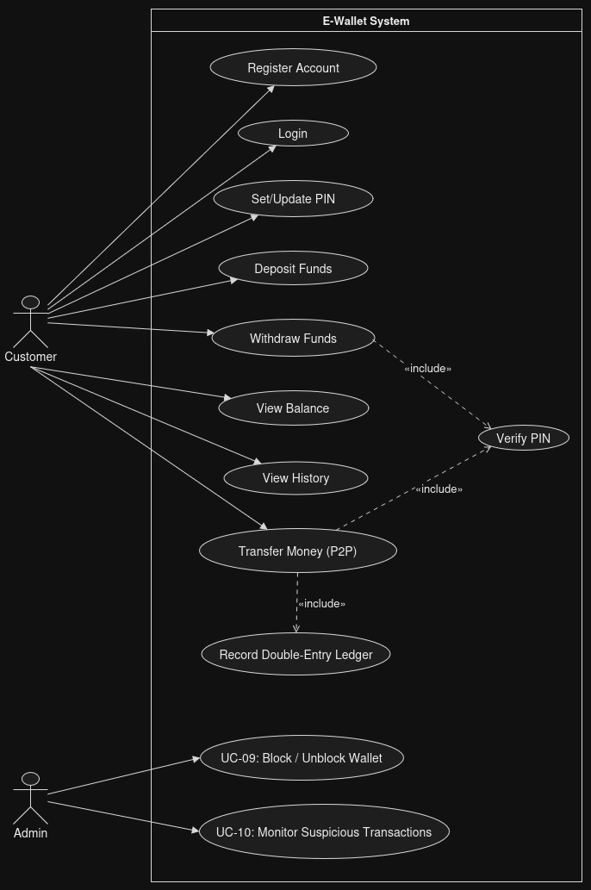
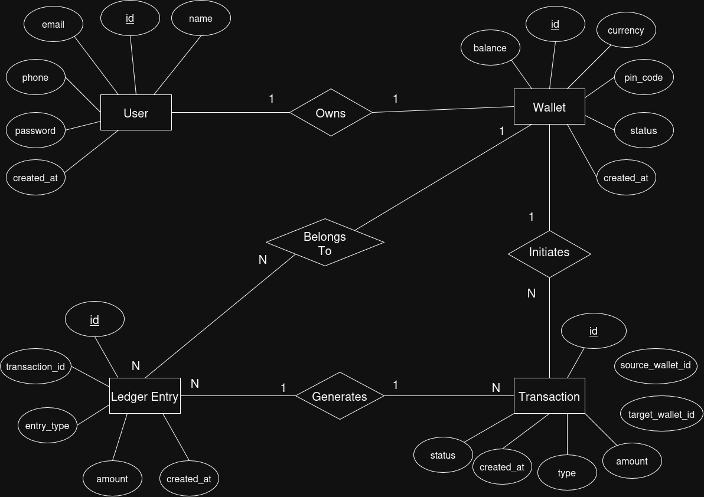
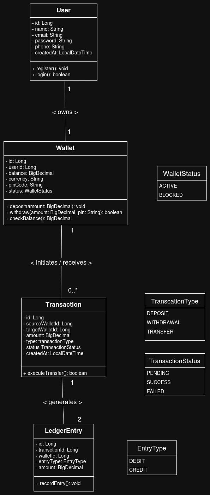
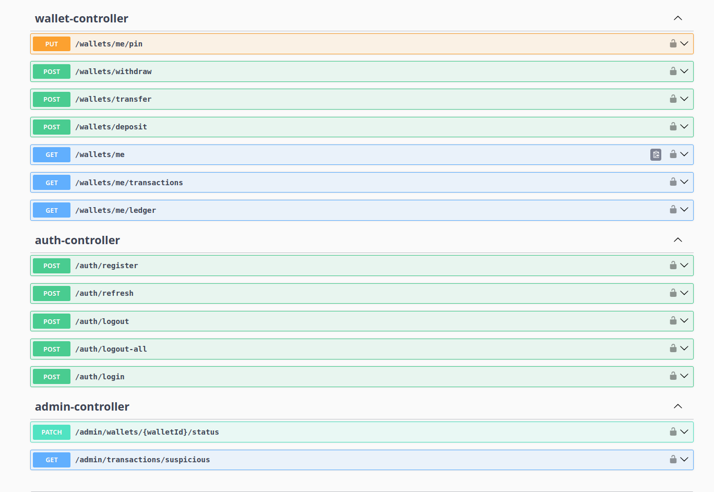

# 💳 E-Wallet System

A production-grade digital wallet and peer-to-peer (P2P) payment backend built with **Java 25**, **Spring Boot 4**, **PostgreSQL 18**, **Redis 8**, and **Docker**. Designed with financial-grade concurrency controls, double-entry bookkeeping, stateless JWT security with multi-device session revocation, and interactive OpenAPI/Swagger documentation.

---

## 🏗️ Core Engineering Highlights

* **Concurrency & Deadlock Prevention:** Uses **Pessimistic Locking** (`@Lock(LockModeType.PESSIMISTIC_WRITE)` / `SELECT ... FOR UPDATE`) on wallet rows during balance mutations. P2P transfers lock wallets in deterministic ID order (`Math.min(id1, id2)` $\rightarrow$ `Math.max(id1, id2)`) to eliminate database deadlocks under concurrent load.
* **Double-Entry Bookkeeping Ledger:** Every transfer atomically persists a master `Transaction` along with two immutable `LedgerEntry` records (`DEBIT` for sender, `CREDIT` for receiver) inside a single `@Transactional` boundary.
* **Distributed Caching (`Redis`):** Caches wallet balance lookups (`@Cacheable`) and automatically evicts stale keys (`@CacheEvict` / programmatic `CacheManager`) on deposits, withdrawals, transfers, PIN updates, or admin wallet blocks.
* **Stateless JWT & Multi-Device Session Revocation:**
  * Short-lived **Access Tokens** (15 min) + rotating **Refresh Tokens** (7 days) stored in Redis with TTL.
  * Supports single-device logout (`jti` blacklisting in Redis) and global **Logout All Devices** (`user_revoked_before:<userId>` timestamp validation).
* **Role-Based Access Control (RBAC):** Strict separation between `ROLE_CUSTOMER` wallet operations and `ROLE_ADMIN` compliance endpoints (`@PreAuthorize`).
* **Automated Test Suite:** Covers Unit Tests (JUnit 5 & Mockito), JPA Repository Slice Tests (`@DataJpaTest`), and End-to-End Integration Tests (`@SpringBootTest` + `MockMvc`).

---

## 🛠️ Tech Stack

| Layer | Technology |
| :--- | :--- |
| **Language & Runtime** | Java 25 (Eclipse Temurin) |
| **Framework** | Spring Boot 4.x (WebMVC, Data JPA, Security, Validation, Cache) |
| **Database** | PostgreSQL 18 (HikariCP connection pool, Hibernate ORM) |
| **Cache & Session Store** | Redis 8 (Lettuce client, `StringRedisTemplate`, `RedisCacheManager`) |
| **Authentication** | JJWT 0.12.6 (HMAC-SHA256), BCrypt password & PIN hashing |
| **API Documentation** | SpringDoc OpenAPI 3 / Swagger UI |
| **Testing** | JUnit 5, Mockito, AssertJ, MockMvc, H2 in-memory DB |
| **Containerization** | Docker (Multi-stage Alpine build) & Docker Compose |

---

## 📊 System Design & Diagrams

### Use Case Diagram


### Entity-Relationship Diagram (ERD)


### Class Diagram


### Swagger UI



---

## 🚀 Quick Start (Docker Compose)

### 1. Clone & Launch the Stack
```bash
git clone [https://github.com/Ahmed-Esawy-1/ewallet-backend.git](https://github.com/Ahmed-Esawy-1/ewallet-backend.git)
cd ewallet-backend
docker compose up -d --build